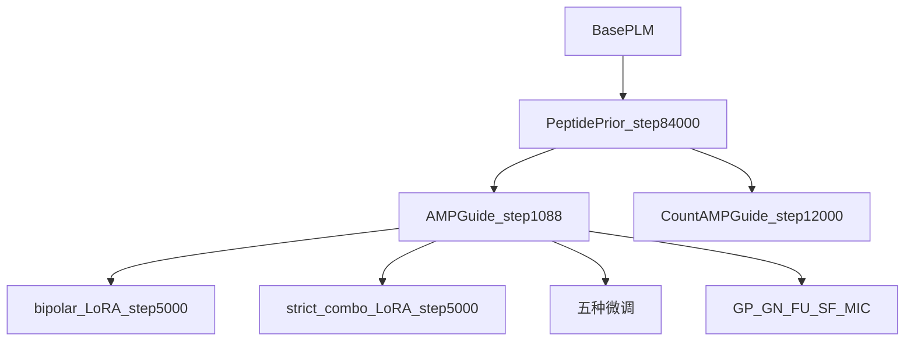

#AMPTailor

这是一套可复现的发布目录，名称与文章一致。多阶段预训练得到四个长度可控模型：`BasePLM`、`PeptidePrior`、`AMPGuide`、`CountAMPGuide`。后面还有六属性微调，以及在 AMPGuide 上训练的五个判别器。权重、训练代码、生成和评估代码、语料都在仓库里。没有训练日志、wandb、中间 checkpoint 和别人的打分器。

四个模型都是 12 层 decoder-only Transformer，约 124M 参数。训练 PeptidePrior、AMPGuide 和 CountAMPGuide 时，氨基酸序列前面加长度条件。格式是：

```text
LEN18:WVRLGRYLLRRLKTPFTR<|endoftext|>
```

## 流水线



`BasePLM` 在 Swiss-Prot 上预训练。`PeptidePrior` 在 5--60 残基的短肽上继续预训练。`AMPGuide` 和 `CountAMPGuide` 分别从 PeptidePrior 适配到 AMP 与 non-AMP 短肽。

六属性模型从 AMPGuide 接着微调，权重在 `models/six_attr_finetune/`：LoRA r16（step 2500）、全参（step 500）、Freeze-top2（step 1000）、LoRA r64（step 1500）、BitFit（step 5000）。括号里是按 composite 选出的 checkpoint。

生成有这些入口：

1. 引导解码：`PeptidePrior + alpha * (AMPGuide - CountAMPGuide)`，提示是 `LEN{n}:`。发布配置用 `alpha=2.0`、`alpha_eos=0.0`。入口是 `scripts/generate_guided.sh`。
2. 双极融合：加载 `models/six_attr_bipolar`，把目标属性前缀和相反属性前缀做 contrast 或 mix。默认 contrast、`alpha=2`。
3. 严格组合：加载 `models/six_attr_strict_combo`，用一条联合前缀，例如 `GP1+GN1+FU1+SF0+LEN18:`。
4. 五种微调：`bash scripts/generate_six_attr_finetune.sh`，用 `METHOD=lora_r16|full_ft|freeze_top2|lora_r64|bitfit` 选择权重。评估用 `bash scripts/eval_six_attr_finetune.sh`，属性分来自下面五个判别器，长度分来自 `LEN{n}:` 生成。

判别器只给生成结果打 GP、GN、FU、SF、MIC。它们的骨干是 AMPGuide。五种微调的评估协议 `src/multi_attr/07.eval_checkpoint_protocol_five_attr_single_lora.py` 也用这五个头：GP、GN、FU、SF 和长度算条件满足率，MIC 只记录分箱分布。

## 环境

见 [ENVIRONMENT.md](ENVIRONMENT.md)。在仓库根目录执行：

```bash
source configs/paths.env
```

`PROJECT_ROOT` 会指到当前仓库。脚本不要改回训练机上的绝对路径。

## 直接生成

不重新训练时，用仓库里的权重：

```bash
bash scripts/generate_guided.sh
bash scripts/generate_bipolar_fusion.sh
bash scripts/generate_strict_combo.sh
bash scripts/score_sequences.sh outputs/generate/bipolar_contrast_L18.fasta
```

常用覆盖：

```bash
TARGET_LENGTH=12 NSAMPLES=100 ALPHA=2.0 bash scripts/generate_guided.sh
BITS=1110 LENGTH=18 N=16 KIND=contrast ALPHA=2 bash scripts/generate_bipolar_fusion.sh
BITS=1110 LENGTH=18 N=16 bash scripts/generate_strict_combo.sh
```

`BITS` 的四位依次是革兰氏阳性、革兰氏阴性、真菌、安全性。`1` 表示要这个活性；安全性里发布判别器把 `1` 标成有毒，`0` 标成低毒。

## 重新训练

输出都写到 `outputs/`，不会覆盖 `models/` 里的发布权重。长度模型的 batch 是按约 96GB 显存设的。

```bash
bash scripts/train_PeptidePrior.sh
bash scripts/train_AMPGuide.sh
bash scripts/train_CountAMPGuide.sh
bash scripts/train_six_attr_bipolar.sh
bash scripts/train_six_attr_strict_combo.sh
bash scripts/train_disentangled_attr_experts.sh
bash scripts/train_hybrid_discriminators.sh

# 五种微调之一。FINETUNE_MODE=lora_r16|full|freeze_top|lora_r64|bitfit
FINETUNE_MODE=lora_r16 bash scripts/train_six_attr_finetune.sh
```

超参和每个权重对应的原 checkpoint 写在 [docs/CHECKPOINTS.md](docs/CHECKPOINTS.md)。

判别器的更早配方（v1、v2、v3、氨基酸词表、全参、原子 LoRA）在 `src/discriminators/`。发布权重只保留最后采用的 hybrid 五个头。

## 目录

```text
models/          发布权重
data/corpus      训练语料
data/splits      判别器序列划分
src/pretrain     BasePLM、PeptidePrior、AMPGuide、CountAMPGuide 的训练
src/multi_attr   六属性 LoRA、五种微调、生成与历史评估协议
src/discriminators
src/generation   引导解码、双极融合、严格组合、五种微调评估、打分
scripts/         可执行入口
outputs/         重训和生成的输出，不纳入版本库
```

## 放到 GitHub

单文件超过 100MB（`model.safetensors` 约 498MB，判别器 `best.pt` 约 517MB，两条语料超过 130MB）。`.gitattributes` 已把这些类型交给 Git LFS。

整包大约 7GB，超过 GitHub 免费 LFS 配额。配额不够时，把 `models/` 和 `data/corpus/` 放到 Hugging Face，GitHub 只留代码、`docs/` 和 `data/splits/`。克隆之后仍然用 `configs/paths.env` 的 `PROJECT_ROOT`，不要把路径写死。

本地已经执行 `git init`，默认分支名是 `main`，Git LFS 已在本仓库启用。大文件在暂存区里是 LFS 指针。尚未提交，也尚未推送。本机没有 `user.name` 和 `user.email`，提交前请先设置。

公开之前请自行加上许可证。BasePLM 的权重来自 Swiss-Prot 预训练检查点，公开时需要同时遵守该上游权重和语料的许可。
