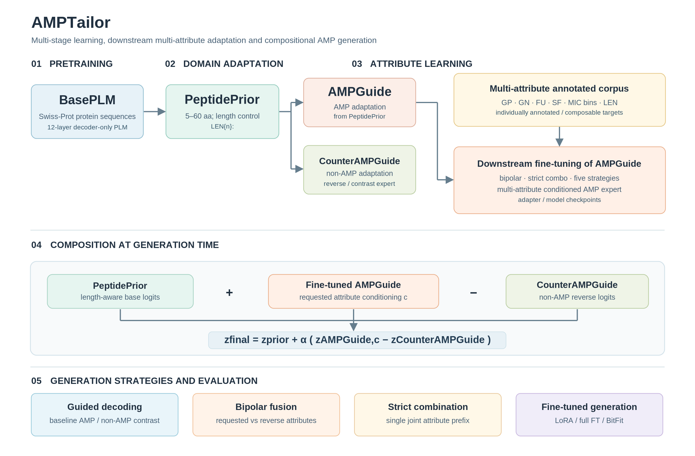

# AMPTailor

**Composable generative-expert guidance enables programmable antimicrobial peptide design**  


AMPTailor generates *de novo* antimicrobial peptides (AMPs) according to user-specified functional requirements. It combines length-controllable generation from a short-peptide language model with composable conditions for antimicrobial activity, safety, and species-specific potency, enabling exploration of candidate sequences under different condition combinations rather than relying solely on generation followed by screening.

This repository provides reproducible **source code, training entry points, generation and evaluation scripts, and documentation**. Large **model weights, tokenizers, configurations, and corpora** are hosted on Hugging Face to keep multi-gigabyte binary weights out of the GitHub commit history. Release materials exclude training logs, Weights & Biases (wandb) records, unrelated intermediate checkpoints, and third-party scorers.

> **Current release status:** The Hugging Face resource repository is currently **Private** and accessible only to authorized users. Links on GitHub do not make the models or data public. The Hugging Face repository can be made public after the manuscript and applicable licenses have been confirmed.

**Resources:**

| Resource | Location | Purpose |
| --- | --- | --- |
| Project code | This GitHub repository | Training, generation, evaluation, and reproducibility documentation |
| [AMPTailor — Hugging Face](https://huggingface.co/53386ljx/AMPTailor) | `53386ljx/AMPTailor` | Model and corpus resources (Private) |
| [Model weights](https://huggingface.co/53386ljx/AMPTailor/tree/main/models) | `models/` | Pretrained models, conditional generation models, and discriminators |
| [Training data](https://huggingface.co/53386ljx/AMPTailor/tree/main/data) | `data/` | Corpora and data splits |
| [Environment guide](ENVIRONMENT.md) | `ENVIRONMENT.md` | Environment and dependencies |
| [Checkpoint guide](docs/CHECKPOINTS.md) | `docs/CHECKPOINTS.md` | Model selection and training steps |

---

## 1. Overview



*Figure 1 | AMPTailor modules for model pretraining, domain adaptation, conditional generation, and attribute evaluation. The diagram summarizes module functions; refer to the corresponding scripts for model calls, condition fusion, and training dependencies.*

### 1.1 Controllable attributes

The framework covers six controllable dimensions:

1. **Length**: Specify peptide length with `LEN{n}:`.
2. **Gram-positive activity (GP)**.
3. **Gram-negative activity (GN)**.
4. **Antifungal activity (FU)**.
5. **Species-specific MIC potency**: Specify potency requirements using a species and MIC bin.
6. **Safety (SF)**: Apply constraints using the binary toxicity labels of the released models.

These attributes can be combined according to the generation method. Generation entry points support different condition representations; follow the argument documentation for each script.

### 1.2 Model progression

BasePLM was pretrained on the reviewed UniProtKB/Swiss-Prot protein dataset. PeptidePrior was initialized from the retained BasePLM checkpoint and further pretrained on length-conditioned short peptides. Two independent copies of the retained PeptidePrior checkpoint were then fine-tuned on the curated AMP and annotation-filtered non-AMP datasets to obtain AMPGuide and CounterAMPGuide, respectively.

All four language models use a **12-layer decoder-only Transformer** architecture with approximately **124M** parameters:

| Model | Training stage | Main role |
| --- | --- | --- |
| `BasePLM` | Pretraining on reviewed UniProtKB/Swiss-Prot protein sequences | General protein sequence prior |
| `PeptidePrior` | Continued pretraining on short peptides of 5–60 aa | Short-peptide generation and length conditioning |
| `AMPGuide` | Fine-tuning an independent copy of retained `PeptidePrior` on curated AMP sequences | Positive AMP generation guidance |
| `CounterAMPGuide` | Non-Fine-tuning an independent copy of retained `PeptidePrior` on curated AMP sequences | Contrastive/reverse generation guidance |

Training sequences for `PeptidePrior`, `AMPGuide`, and `CounterAMPGuide` include an explicit length prefix, for example:

```text
LEN18:WVRLGRYLLRRLKTPFTREOS
```

`EOS` is the actual special end token. Tokenizer loading preserves the original end-token ID, so retained model weights remain compatible. Legacy corpus markers are normalized to `EOS` before training.

Here, `LEN18:` requests a length of 18; generation uses a `LEN{n}:` prompt. `BasePLM` represents the general protein pretraining stage and should be distinguished from subsequent length-conditioned adaptation.

**Main released checkpoints (see `docs/CHECKPOINTS.md`):** `PeptidePrior` step 84000, `AMPGuide` step 1088, and `CounterAMPGuide` step 12000. Six-attribute branches and discriminators are described below.

---

## 2. Model weights and training data

Model weights and corpora are hosted in the same Hugging Face **model repository**, under two top-level directories:

```text
AMPTailor/                         # Hugging Face: 53386ljx/AMPTailor
├── models/
│   ├── BasePLM/
│   ├── PeptidePrior/
│   ├── AMPGuide/
│   ├── CounterAMPGuide/
│   ├── six_attr_bipolar/
│   ├── six_attr_strict_combo/
│   ├── six_attr_disentangle/
│   ├── six_attr_finetune/
│   └── discriminators/
└── data/
    ├── corpus/
    └── splits/
```

- **`models/`**: Released weights, tokenizers, model configurations, adapters, and related files.
- **`data/corpus/`**: Data resources for pretraining and domain adaptation.
- **`data/splits/`**: Sequence splits for discriminator training and evaluation.
- **`models/six_attr_disentangle/`**: Additional attribute-specific adaptation results; see the corresponding code and checkpoint documentation for their use.

### Download models and corpora

First, install the Hugging Face CLI:

```bash
python3 -m pip install -U huggingface_hub
```

**While the resource repository remains Private**, log in with a Hugging Face account that has access:

```bash
hf auth login
hf auth whoami
```

Run the following from **the root of your cloned GitHub project**:

```bash
hf download 53386ljx/AMPTailor \
  --repo-type model \
  --include "models/**" "data/**" \
  --local-dir .
```

This command creates or completes `models/` and `data/` in the current directory while preserving their relative paths on Hugging Face. To download only models, use `--include "models/**"`; to download only corpora, use `--include "data/**"`.

> **Important:** If you maintain the code repository, ensure your local `.gitignore` excludes `models/` and any large corpora you do not intend to commit to GitHub before downloading weights. This prevents accidental inclusion of models or corpora in Git commits. Once the Hugging Face repository is public, users downloading public resources will no longer need repository-specific authentication.

---

## 3. Generation

Target length is supplied as a conditioning prompt. Generation stops at the first EOS token predicted for each sequence; outputs are not padded or truncated to the requested length. `max_new_tokens` is only a safety cap. Length errors should be measured on the generated sequences.

AMPTailor provides four complementary generation entry points. Each organizes conditions differently to support reproduction of length-control, contrastive-guidance, and six-attribute composition experiments.

### 3.1 Contrastive guided decoding

Prediction signals from the short-peptide prior and the AMP/non-AMP guidance models are combined during generation. Conceptually:

$$
\mathrm{Guidance}=\mathrm{PeptidePrior}+\alpha\,(\mathrm{AMPGuide}-\mathrm{CounterAMPGuide}).
$$

This is a **guided combination of generation scores/logits**, not a direct sum of three sets of model weights. The released configuration uses `alpha=2.0`, `alpha_eos=0.0`, and the length prompt `LEN{n}:`.

```bash
bash scripts/generate_guided.sh
```

Custom example:

```bash
TARGET_LENGTH=12 NSAMPLES=100 ALPHA=2.0 bash scripts/generate_guided.sh
```

### 3.2 Bipolar fusion

Using adapter weights from `models/six_attr_bipolar/`, this method combines requested and reverse attribute conditions through `contrast` or `mix` fusion. The default is `contrast` with `alpha=2`.

```bash
bash scripts/generate_bipolar_fusion.sh
```

For example, request GP, GN, and FU activity together with low toxicity:

```bash
BITS=1110 LENGTH=18 N=16 KIND=contrast ALPHA=2 \
  bash scripts/generate_bipolar_fusion.sh
```

### 3.3 Strict-combination conditioning

Using `models/six_attr_strict_combo/`, specify target attributes with a single joint condition prefix, for example:

```text
GP1+GN1+FU1+SF0+LEN18:
```

Run:

```bash
bash scripts/generate_strict_combo.sh
```

Custom example:

```bash
BITS=1110 LENGTH=18 N=16 bash scripts/generate_strict_combo.sh
```

**`BITS` encoding:** The four positions represent GP, GN, FU, and SF, in that order. For GP/GN/FU, `1` requests the corresponding antimicrobial activity. For the released SF labels, `1` means toxic and `0` means low toxicity. Thus, `1110` requests **GP+ / GN+ / FU+ / low toxicity**, rather than setting all four positions to `1`.

### 3.4 Six-attribute fine-tuning

Five strategies for continued fine-tuning of `AMPGuide` are stored in `models/six_attr_finetune/`:

| Method | Training/adaptation strategy | Released checkpoint step |
| --- | --- | ---: |
| `lora_r16` | LoRA rank 16 | 2500 |
| `full_ft` | Full-parameter fine-tuning | 500 |
| `freeze_top2` | Freeze-top2 | 1000 |
| `lora_r64` | LoRA rank 64 | 1500 |
| `bitfit` | BitFit | 5000 |

These are checkpoint steps selected using the composite metric; they do not imply that all five methods have the same total training duration.

```bash
bash scripts/generate_six_attr_finetune.sh
bash scripts/eval_six_attr_finetune.sh
```

To select a generation/evaluation method:

```bash
METHOD=lora_r16 bash scripts/generate_six_attr_finetune.sh
```

---

## 4. Discriminators and evaluation

The five released hybrid discriminator heads use an `AMPGuide` backbone and evaluate:

| Abbreviation | Attribute |
| --- | --- |
| `GP` | Gram-positive activity |
| `GN` | Gram-negative activity |
| `FU` | Antifungal activity |
| `SF` | Safety/toxicity label |
| `MIC` | Species-specific MIC potency bin |

Scoring entry point:

```bash
bash scripts/score_sequences.sh outputs/generate/bipolar_contrast_L18.fasta
```

The historical checkpoint evaluation protocol for six-attribute fine-tuning is located at:

```text
src/multi_attr/07.eval_checkpoint_protocol_five_attr_single_lora.py
```

This protocol uses GP, GN, FU, and SF predictions together with the length condition to compute condition satisfaction rates, and records MIC-bin distributions. **Recording MIC distributions is not equivalent to measuring strict joint satisfaction of all six attributes.** Reproduce manuscript results using the evaluation scripts and definitions for the specific experiment.

Earlier discriminator training recipes (v1/v2/v3, amino-acid vocabulary, full-parameter training, atomic LoRA, and others) remain in `src/discriminators/`. The model resource repository retains only the five hybrid heads used in the final configuration.

---

## 5. Installation and quick start

See [ENVIRONMENT.md](ENVIRONMENT.md) for installation requirements, the Python environment, and hardware/software details.

```bash
# Run from the root of your cloned GitHub project
source configs/paths.env
```

`PROJECT_ROOT` should point to the current repository. Do not replace it with an absolute path from the original training server.

**After downloading the weights, run the following without retraining:**

```bash
bash scripts/generate_guided.sh
bash scripts/generate_bipolar_fusion.sh
bash scripts/generate_strict_combo.sh
bash scripts/score_sequences.sh outputs/generate/bipolar_contrast_L18.fasta
```

The final scoring command requires the specified FASTA file to have been produced by an upstream generation task. Output paths may vary with script arguments.

---

## 6. Re-training

Retraining outputs are written to `outputs/` without intentionally overwriting released weights in `models/`. Default batch settings for length-model training assume approximately **96 GB of GPU memory**. Adjust batch sizes or related training parameters for smaller GPUs.

```bash
bash scripts/train_PeptidePrior.sh
bash scripts/train_AMPGuide.sh
bash scripts/train_CounterAMPGuide.sh
bash scripts/train_six_attr_bipolar.sh
bash scripts/train_six_attr_strict_combo.sh
bash scripts/train_disentangled_attr_experts.sh
bash scripts/train_hybrid_discriminators.sh
```

Select one of the five six-attribute fine-tuning strategies:

```bash
# FINETUNE_MODE: lora_r16 | full | freeze_top | lora_r64 | bitfit
FINETUNE_MODE=lora_r16 bash scripts/train_six_attr_finetune.sh
```

Note that training uses `FINETUNE_MODE=full` / `freeze_top`, whereas generation and evaluation use `METHOD=full_ft` / `freeze_top2`. These **names differ**; use the values accepted by each script.

See [docs/CHECKPOINTS.md](docs/CHECKPOINTS.md) for training hyperparameters, original checkpoints, and selection criteria for each released model.

---

## 7. Repository layout

The following illustrates the GitHub code layout. Download large `models/` and `data/corpus/` resources separately using the Hugging Face command above.

```text
AMPTailor/
├── README.md
├── ENVIRONMENT.md
├── requirements.txt
├── configs/
│   └── paths.env
├── docs/
│   ├── CHECKPOINTS.md
│   └── assets/
│       └── amptailor_pipeline.png
├── scripts/                  # Training, generation, and evaluation entry points
├── src/
│   ├── pretrain/             # BasePLM / PeptidePrior / AMPGuide / CounterAMPGuide
│   ├── multi_attr/           # Six-attribute adaptation, fine-tuning, and evaluation protocols
│   ├── discriminators/       # Discriminator training and historical configurations
│   └── generation/           # Guided decoding, conditional generation, and scoring
├── data/
│   ├── splits/               # Small split files (optional, depending on release policy)
│   └── corpus/               # Large corpora hosted on Hugging Face
├── models/                   # Model weights hosted on Hugging Face
└── outputs/                  # Generation and retraining outputs (excluded from version control)
```

### File responsibilities on GitHub and Hugging Face

Because `model.safetensors`, `best.pt`, and some corpus files may exceed standard GitHub Git file-size limits, the recommended split is:

- **GitHub:** `src/`, `scripts/`, `configs/`, `docs/`, `README.md`, environment files, and small data suitable for version control.
- **Hugging Face:** `models/`, `data/corpus/`, and other centrally managed data resources.
- **Exclude from commits:** `outputs/`, training logs, wandb directories, and unrelated intermediate checkpoints.

Configuring Git LFS in `.gitattributes` **does not guarantee that free GitHub LFS storage and bandwidth quotas can accommodate all models**. If models or corpora have been staged, inspect the Git index and commit history before pushing to avoid uploading large files, including LFS objects.

---

## 8. Reproducibility and release notes

- **Reproducibility:** Model configurations, tokenizers, checkpoint selection criteria, and training/evaluation entry points should match the corresponding released version.
- **Private phase:** Current Hugging Face links are accessible only to authorized users. Publishing the GitHub README does not make private weights public.
- **Public release:** Before release, verify redistribution rights for training data and upstream resources, particularly Swiss-Prot-derived corpora, other collected AMP/non-AMP data, and original pretrained weights.
- **Licensing:** Add appropriate LICENSE files, model cards, and dataset documentation once the licensing terms for code, models, and data are established.
- **Citation:** Add the manuscript title, formal citation, DOI, and versioned release information when confirmed. Do not include unconfirmed citation entries.

> **Public release checklist:** Validate all model and data files, add model usage examples, verify licenses and data redistribution rights, select the public version, and update the access-status statement in this README after making the Hugging Face repository public.
